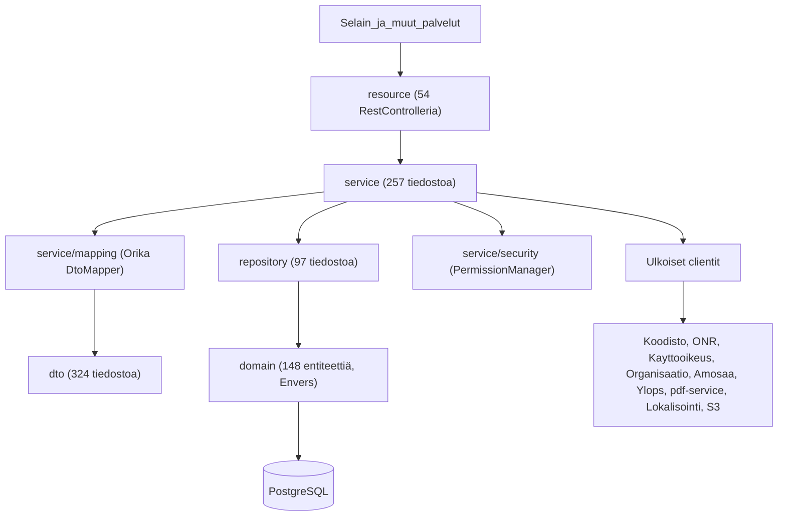
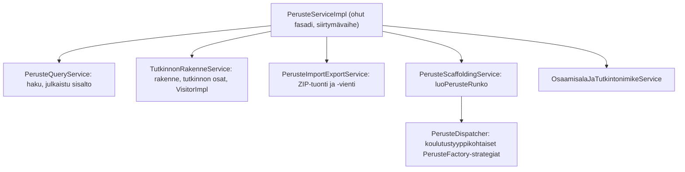
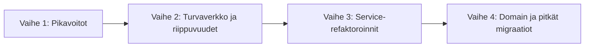

# eperusteet-service - parannussuunnitelma

| Tieto | Arvo |
|---|---|
| Dokumentin luontipäivä | 19.10.2026 (analyysi tehty 16.10.2026) |
| Laatija | Cursor-agentti |
| Käytetty malli | Claude Opus 5.5 |
| Laajuus | `eperusteet-service` (Spring Boot 4.1.1, Java 21) |
| Koko | noin 1011 Java-tiedostoa / noin 66 000 riviä (main), 84 tiedostoa / noin 15 800 riviä (test) |

Luvut perustuvat staattiseen koodianalyysiin (`wc -l`, hakulausekkeet, käsin luetut luokat). Ne ovat suuntaa-antavia ja kannattaa tarkistaa ennen kunkin työn aloittamista.

---

## 1. Yhteenveto

Sovelluksen teknologinen pohja on ajantasainen: Spring Boot 4.1.1, Spring Framework 7, Hibernate 7.4, Flyway 12, springdoc 3 ja jakarta-nimiavaruus. Tekninen velka ei siis johdu vanhasta alustasta, vaan seuraavista asioista:

1. **Suuret service-luokat (god class).** `PerusteServiceImpl` on 2845 riviä ja siinä on 41 kenttäinjektoitua riippuvuutta. `PerusteprojektiServiceImpl` ja `JulkaisutServiceImpl` riippuvat toisistaan syklisesti `@Lazy`-injektion kautta, ja sovellus vaatii asetuksen `spring.main.allow-circular-references=true`.
2. **Vanhentunut DTO-mappaus.** Orika 1.5.4 on käytännössä hylätty projekti, ja sen konfiguraatio `DtoMapperConfig` on 971 riviä.
3. **Testit.** Noin 64 testitiedostoa käyttää JUnit 4:ää ja XML-pohjaista Spring-kontekstia. Oletusintegraatiotestit ajetaan H2:lla, joten ne eivät vastaa tuotannon PostgreSQL:ää.
4. **Riippuvuuksien hajanaisuus.** Kuusi OPH:n SNAPSHOT-kirjastoa, rinnakkain Jackson 2 ja 3, HttpClient 4 ja 5, commons-collections 3 ja 4, Joda-Time sekä testikirjastoja compile-scopessa.

Suurin hyöty saadaan pilkkomalla `PerusteServiceImpl` ja purkamalla julkaisun ja projektin tilan välinen sykli. Pienimmällä työllä saadaan pikavoittoja: korjataan riippuvuuksien scopet, poistetaan migraatioapukirjasto ja korjataan hiljaiset `catch`-lohkot.

---

## 2. Arkkitehtuuri

### 2.1 Kerrokset

| Paketti | Tiedostoja | Rivejä (noin) | Rooli |
|---|---:|---:|---|
| `dto` | 324 | 8 900 | API- ja siirto-oliot |
| `service` | 257 | 27 000 | Liiketoimintalogiikka, validointi, mappaus, oikeudet, ajastukset |
| `domain` | 237 | 17 000 | JPA-entiteetit, Envers-auditointi |
| `repository` | 97 | 3 900 | Spring Data JPA, Criteria API, natiivi-SQL |
| `resource` | 66 | 7 100 | REST-rajapinnat (springdoc) |
| `config` | 23 | 1 500 | Tietoturva, async, cache, Flyway, Jackson, AWS |
| `aop` | 2 | 50 | `PerformanceMonitorAspect` |
| `security` | 0 | 0 | Tyhjä paketti |

### 2.2 Poikkileikkaavat ratkaisut

- **Tietoturva:** CAS (`spring-security-cas` ja OPH:n `opintopolku-cas-servlet-filter`), `WebSecurityConfiguration` ja kehitysversio `WebSecurityConfigurationDev`. Metoditason oikeudet hoidetaan `@EnableMethodSecurity`-annotaatiolla ja `PermissionEvaluator`/`PermissionManager`-luokilla. Sessiot tallennetaan Spring Session JDBC:llä.
- **Välimuisti:** Spring Cache ja Ehcache 3 (JCache, `jcache.xml`) sekä Hibernaten toisen tason välimuisti (`eperusteet-hibernate-ehcache.xml`).
- **Ajastukset:** `ScheduledConfiguration` ajaa joka yö kello 01:00 kaikki `ScheduledTask`-beanit (`service/tasks/`: julkaisujen ja navigaation välimuistit, Amosaa- ja Ylops-tilastot, Lampi-vienti S3:een) sekä tunneittain session-siivouksen.
- **Async:** `AsyncConfig` (`julkaisuTaskExecutor`) ja `DokumenttiAsyncConfig`. Tietoturvakonteksti välitetään `DelegatingSecurityContextAsyncTaskExecutor`illa.
- **Ulkoiset integraatiot:** `KoodistoClientImpl`, `AmosaaClientImpl`, `YlopsClientImpl`, `ExternalPdfServiceImpl`, `KayttajanTietoServiceImpl` (ONR ja käyttöoikeus), `UlkopuolisetServiceImpl` (organisaatio) ja `LokalisointiServiceImpl` (`RestTemplate`). Pääosa kutsuista kulkee `OphHttpClient`/`RestClientFactory`-luokkien kautta.
- **Tietokantamigraatiot:** Flywayssa on 339 SQL-migraatiota (`src/main/resources/db/migration`) ja 4 Java-migraatiota (`src/main/java/db/migration`). Asetukset ovat `outOfOrder(true)` ja historiataulu `schema_version`.
- **CI:** `.github/workflows/build.yml` rakentaa käyttöliittymän, ajaa `mvn clean verify -Pit` ja rakentaa kontin `ci-tools`-työkaluilla. Repositoriossa ei ole omaa Dockerfilea.

### 2.3 Havainnot

- Kerrosjako on selkeä, mutta service-kerros on paisunut: siinä on 41 % main-koodin riveistä.
- `spring.main.allow-circular-references=true` (`application.properties` rivi 6) piilottaa riippuvuussyklejä.
- `spring.mvc.pathmatch.matching-strategy=ant-path-matcher` (rivi 19) on vanhentuva asetus.
- Kaikki riippuvuudet tulevat ulkoisesta `eperusteet-parent-pom:4.1.1-11`-pomista, joten riippuvuuskorjaukset tehdään pääosin parent-pomiin.

---

## 3. Sovelluslogiikka

### 3.1 Validointi

- Rajapinta `service/Validator.java` määrittelee, mihin koulutustyyppiin, toteutukseen, tilaan ja perustetyyppiin validaattori soveltuu.
- `ProjektiValidatorImpl` saa kaikki validaattorit listana (`List<Validator>`), suodattaa soveltuvat ja yhdistää tulokset `ValidointiKategoria`n mukaan. Malli on hyvä.
- Ongelma on se, että `ValidatorPeruste` (743 riviä) sisältää 248-rivisen `validate`-metodin, joka kattaa ammatillisen koulutuksen, perusopetuksen ja tekstitarkistukset samassa metodissa.

### 3.2 Koulutustyyppikohtainen strategia

- `PerusteToteutus` ja `PerusteDispatcher` valitsevat oikean beanin `KoulutustyyppiToteutus`-arvon perusteella. Tätä käytetään navigaatiossa (`NavigationBuilder*`) ja importissa (`PerusteImport*`).
- Perusteen luonti (`luoPerusteRunko`) ja päivitys (`update`) haarautuvat kuitenkin edelleen `PerusteServiceImpl`issä if/else-ketjuilla `KoulutusTyyppi`n mukaan. Luokassa on noin 91 viittausta koulutustyyppiin tai toteutukseen.

### 3.3 Julkaisuvirta

```mermaid
flowchart LR
    tila["PerusteprojektiServiceImpl.updateTila"] --> teeJulkaisu["JulkaisutServiceImpl.teeJulkaisu"]
    teeJulkaisu --> asyncJulkaisu["teeJulkaisuAsync (Async)"]
    asyncJulkaisu --> validoi["validoiProjekti"]
    validoi --> tilat["PerusteTila VALMIS, ProjektiTila JULKAISTU"]
    tilat --> koodit["kooditaValiaikaisetKoodit"]
    koodit --> snapshot["getKaikkiSisalto, JSON-snapshot"]
    snapshot --> pdf["generoiJulkaisuPdf, pdf-service"]
    pdf --> tallennus["JulkaistuPeruste ja maarayskokoelma"]
```

- `JulkaisutServiceImpl` sisältää validoinnin, tilamuutokset, koodituksen, PDF-orkestroinnin, määräyskytkennät ja välimuistin käsittelyn.
- Luokkatason `@Transactional` koskee myös pitkäkestoista async- ja PDF-työtä.
- `JulkaisutServiceImpl` ja `PerusteprojektiServiceImpl` injektoivat toisensa `@Lazy`-annotaatiolla. Lisäksi `JulkaisutServiceImpl` injektoi itsensä (`self`) async-proxyn takia.

### 3.4 Tilakone

- `ProjektiTila.mahdollisetTilat(PerusteTyyppi)` määrittää sallitut siirtymät (POISTETTU, LAADINTA, KOMMENTOINTI, VIIMEISTELY, VALMIS, JULKAISTU).
- Siirtymien sivuvaikutukset (koodisto, tiedote, julkaisu, `setPerusteTila`) ovat imperatiivisina if-ketjuina `PerusteprojektiServiceImpl`-luokan metodeissa `updateTila`, `updateProjektiTila` ja `avaaPerusteProjekti`.
- Rinnalla on erilliset tilat `PerusteTila`, `JulkaisuTila` ja `DokumenttiTila`.

### 3.5 PDF-putki

`DokumenttiServiceImpl.generateWithDto` kutsuu `ExternalPdfServiceImpl`iä, joka lähettää HTTP POST -pyynnöllä `PerusteKaikkiDto`:n pdf-servicelle. Takaisinkutsu kulkee `@Lazy DokumenttiService` -viittauksen kautta. PDF:n generointi on hyvin eriytetty omaan palveluunsa, mutta sen orkestrointi on upotettu julkaisuun.

---

## 4. Servicet

### 4.1 Suurimmat luokat

| Luokka | Rivejä | Julkisia metodeja | `@Autowired` | Huomiot |
|---|---:|---:|---:|---|
| `service/impl/PerusteServiceImpl` | 2845 | ~91 | 41 | Pisimmät metodit `update` (138 riviä) ja `tarkistaUniikitKoodit` (101 riviä). `luoPerusteRunko`-metodissa on if-ketju koulutustyypin mukaan. Luokka injektoi itsensä (`self`). `@Transactional` on private-metodeilla. Tyhjä `catch` riveillä 468-469. |
| `service/impl/PerusteprojektiServiceImpl` | 1075 | ~27 | 27 | `@Lazy JulkaisutService`, `save` 124 riviä, `@Transactional` private-metodeilla. |
| `service/mapping/DtoMapperConfig` | 971 | - | - | Orika-konfiguraatio yhdessä luokassa. |
| `service/impl/JulkaisutServiceImpl` | 836 | ~18 | 22 | Kaksi `@Lazy`-injektiota (`PerusteprojektiService` ja `self`), luokkatason `@Transactional`, `@Profile("!test")`. |
| `service/impl/PerusteenOsaServiceImpl` | 752 | ~40 | 19 | `@Transactional` private-apumetodeilla. |
| `service/impl/validators/ValidatorPeruste` | 743 | ~10 | 4 | `validate` 248 riviä. `catch` lokittaa virheen ja jatkaa. |
| `service/security/PermissionManager` | 646 | ~7 | 8 | `hasPermission` 103 riviä. Kovakoodatut oikeudet on merkitty TODO:lla. |
| `service/impl/yl/Lops2019ServiceImpl` | 569 | ~20 | 9 | FIXME käänteisestä mappauksesta. |
| `service/impl/yl/OppiaineServiceImpl` | 544 | ~17 | 10 | Neljä `instanceof`-tarkistusta, transaktioilta puuttuu `readOnly`. |
| `service/impl/AmmattitaitovaatimusServiceImpl` | 535 | - | - | Luokkatason `@Transactional`, koodistosynkronointi. |
| `service/impl/yl/AIPEOpetuksenPerusteenSisaltoServiceImpl` | 533 | ~36 | 8 | Hierarkia-CRUD, joka on päällekkäinen Oppiaine- ja VLK-palvelujen kanssa. |
| `service/impl/KoodistoClientImpl` | 508 | - | - | Kolme `catch (Exception)` -lohkoa, jotka lokittavat ja nielevät virheen. |
| `service/impl/MaintenanceServiceImpl` | 383 | - | - | Massajulkaisu (`Propagation.NEVER`), nielee välimuistivirheet. |

### 4.2 Yleiset havainnot

- **Injektio:** noin 119 service-tiedostoa käyttää kenttäinjektiota (`@Autowired`). Konstruktori-injektio (`@RequiredArgsConstructor`) on käytössä vain noin kolmessa.
- **Syklit:** koodissa on 10 `@Lazy`-injektiota 9 tiedostossa: julkaisu ja projekti, julkaisun `self`, PDF-takaisinkutsu, `DtoMapperConfig`, `JulkinenServiceImpl` ja ajastetut tehtävät.
- **Transaktiot:** `@Transactional` private-metodeilla ei tee mitään, koska Spring AOP ei sieppaa luokan sisäisiä kutsuja. Annotaatio on siis harhaanjohtava.
- **Poikkeukset:** `catch (Exception` esiintyy 20 kertaa noin 15 tiedostossa. Osa lohkoista nielee virheen kokonaan.
- **Merkinnät:** TODO 10 kpl, FIXME 4 kpl, `@Deprecated` 40 kpl (25 tiedostossa), `System.out` 0 kpl.
- **Päällekkäisyys:** AIPE-, Oppiaine- ja VuosiluokkaKokonaisuus-palveluissa on samankaltaista hierarkian CRUD-, järjestys- ja revisiopalautuslogiikkaa. Navigaatiossa on rinnakkaiset `NavigationBuilder`- ja `NavigationBuilderPublic`-toteutukset kullekin koulutustyypille.

### 4.3 Ehdotettu `PerusteServiceImpl`-luokan pilkkominen

Rajapinta `PerusteService` voidaan säilyttää siirtymävaiheen ajan, jolloin kutsujat eivät muutu. Toteutus delegoi uusille luokille, ja kutsujat siirretään vähitellen käyttämään niitä suoraan.

---

## 5. Testit

| Mittari | Arvo |
|---|---|
| Testitiedostoja | 84, joista 65 sisältää `@Test`-metodeja |
| `@Test`-metodeja | 357 |
| `@ParameterizedTest` | 0 |
| JUnit 4 | noin 64 tiedostoa (`SpringJUnit4ClassRunner`) |
| JUnit 5 | 1 tiedosto (`LampiExportServiceTest`) |
| Kirjastot | AssertJ (52 tiedostoa), Mockito (10 tiedostoa), Testcontainers JDBC-URL:n kautta |
| `@Ignore` / `@Disabled` / `Thread.sleep` | 0 / 0 / 0 |
| ArchUnit | Ei käytössä |
| JaCoCo | Konfiguroitu parent-pomissa (UT- ja IT-raportit erikseen) |

### 5.1 Testiinfrastruktuuri

| Pohjaluokka | Tietokanta | Käyttäjiä |
|---|---|---:|
| `AbstractIntegrationTest` | H2 in-memory (`it-test-context.xml`, `hbm2ddl.auto=create` ja Flyway samaan aikaan) | 33 |
| `AbstractPerusteprojektiTest` | Kuten edellä, lisäksi `@DirtiesContext` | 8 |
| `AbstractDockerIntegrationTest` | Testcontainers PostgreSQL 15.7 (`it-docker-test-context.xml`) | 5 |
| `AbstractDbIntegrationTest` | Ulkoinen PostgreSQL (`it-db-test-context.xml`) | 1 |
| `@SpringBootTest` | Koko Boot-konteksti | 5 |

### 5.2 Havainnot

- Oletusintegraatiotestit ajetaan H2:lla, ja skeema luodaan sekä Hibernaten `create`-tilassa että Flywaylla. Tuotannon PostgreSQL-käyttäytyminen (natiivikyselyt, JSONB) ei tule testatuksi.
- `it-db-test-context.xml` käyttää PostgreSQL-ajuria mutta `H2Dialect`-dialektia.
- 54 controllerista vain kolmella on oma IT-testi (`ExternalControllerIT`, `MaaraysControllerIT`, `ControllerPermissionIT`).
- Ilman omaa testiluokkaa ovat muun muassa `KayttajanTietoServiceImpl`, `KommenttiServiceImpl`, `LokalisointiServiceImpl`, `JulkinenServiceImpl`, `LaajaalainenOsaaminenServiceImpl`, `UlkopuolisetServiceImpl`, `TermistoServiceImpl`, `LiiteTiedostoServiceImpl` ja useimmat `*LockServiceImpl`-luokat.
- Ulkoiset palvelut on mockattu (`KoodistoClientMock`, `YlopsClientMock`, `KayttajanTietoServiceMock`, `DokumenttiServiceMock`, `JulkaisutServiceMock`). Tämä on hyvä käytäntö, mutta `JulkaisutServiceImpl`in `@Profile("!test")` tarkoittaa, että oikea julkaisulogiikka testataan vain `@SpringBootTest`-testeissä.
- `ControllerPermissionIT`issä on käyttämätön `@Ignore`-import.

---

## 6. Riippuvuudet

Riippuvuudet periytyvät lähes kokonaan parent-pomista `eperusteet-parent-pom:4.1.1-11`. Moduulin oma `pom.xml` lisää vain AWS SDK:n (S3, STS) ja OpenCSV:n.

| Riippuvuus | Versio | Ongelma |
|---|---|---|
| Orika (`orika-core`) | 1.5.4 | Hylätty projekti. Perustuu ajonaikaiseen bytecode-generointiin ja vaatii erillisen Hibernate unenhance -strategian. Mappausvirheet näkyvät vasta ajon aikana. |
| OPH SNAPSHOT -kirjastot | `eperusteet-backend-utils` 3.3-SNAPSHOT, `java-http` 1.0.2-SNAPSHOT, `java-properties` 1.0.0-SNAPSHOT, `opintopolku-cas-servlet-filter` 1.0.1-SNAPSHOT, `opintopolku-user-details-service` 0.5.2-SNAPSHOT, `auditlogger` 9.2.7-SNAPSHOT | Buildit eivät ole toistettavia, ja tuotantoon voi päätyä tarkistamatonta koodia. |
| JUnit 4 ja `junit-vintage-engine` | 4.13.2 / 6.0.3 | Kaksi testimoottoria rinnakkain. JUnit 4 ei enää kehity. |
| Joda-Time ja `jackson-datatype-joda` | 2.12.7 / 2.21.5 | Korvattu `java.time`-rajapinnalla jo Java 8:ssa. Käytössä 8 tiedostossa (main). |
| Jackson 2 (`com.fasterxml`) ja Jackson 3 (`tools.jackson`) | 2.21.5 / 3.1.5 | Boot 4:n oletus on Jackson 3, mutta sovellus käyttää Jackson 2:ta `spring-boot-jackson2`-moduulin kautta. Kaksi JSON-pinoa samassa sovelluksessa. |
| Apache HttpClient 4 ja 5 | 4.5.13 / 5.6.4 | Kaksi HTTP-asiakasta. Versio 4.x on elinkaarensa lopussa. |
| commons-collections 3 ja commons-collections4 | 3.2.2 / 4.5.0 | Päällekkäiset kirjastot. Versio 3 on elinkaarensa lopussa. |
| commons-digester (transitiivinen, `commons-validator` 1.7) | 2.1 | Erittäin vanha. |
| `spring-boot-properties-migrator` | 4.1.1 | Tarkoitettu vain migraation ajaksi, mutta on ajonaikaisessa classpathissa. |
| `mockito-core`, `jacoco-maven-plugin`, `easy-random` | 5.23.0 / 0.8.14 / 4.1.0 | Compile-scopessa, joten ne päätyvät tuotanto-JARiin. |
| commons-dbcp2 | 2.14.0 | Turha, koska HikariCP on käytössä. |
| Gson | 2.13.2 | Toinen JSON-kirjasto Jacksonin rinnalla. |
| Batik (osat) | 1.13 | Vanha. Vain i18n- ja constants-osat ovat mukana. `fop.version` on parent-pomissa turhana. |
| PDFBox | 2.0.29 | Versio 3.x on saatavilla. |
| StreamEx | 0.6.5 | Ei aktiivisesti päivitetty. Useimmat käyttökohteet voi korvata Java 21:n Stream-rajapinnalla. |
| `javax.el` (testit) | 3.0.0 | Vanha javax-nimiavaruus testiclasspathissa. |

Positiivista: springfox on vaihdettu springdociin, jakarta-migraatio on tehty (jäljellä olevat `javax.*`-viittaukset ovat JDK:n omia rajapintoja), ja Guava, Hibernate, Flyway sekä PostgreSQL-ajuri ovat ajan tasalla.

---

## 7. Parannusehdotukset

Asteikot:

- **Vaikutus:** Korkea / Keski / Matala. Kuvaa hyötyä ylläpidettävyydelle, luotettavuudelle tai tietoturvalle.
- **Kriittisyys:** Kriittinen / Korkea / Keski / Matala. Kuvaa, kuinka kiireellinen korjaus on riskin kannalta.
- **Työmäärä:** S (alle 2 päivää), M (noin 1 viikko), L (2-4 viikkoa), XL (yli 1 kuukausi).

### 7.1 Service-luokkien refaktorointi

| ID | Alue | Ehdotus | Perustelu / havainto | Vaikutus | Kriittisyys | Työmäärä |
|---|---|---|---|---|---|---|
| R1 | Service | Pilko `PerusteServiceImpl` osiin: `PerusteQueryService`, `TutkinnonRakenneService`, `PerusteImportExportService`, `PerusteScaffoldingService` ja `OsaamisalaJaTutkintonimikeService`. Säilytä `PerusteService` fasadina siirtymän ajan. | 2845 riviä, noin 91 julkista metodia ja 41 riippuvuutta. Luokka sisältää haun, CRUD-toiminnot, rakenteen, tuonnin ja viennin, koulutustyyppikohtaisen rungon luonnin ja mappauksen. Muutosten riskit ja yhdistämiskonfliktit kasaantuvat tähän luokkaan. | Korkea | Kriittinen | XL |
| R2 | Service | Siirrä `luoPerusteRunko`- ja `update`-metodien `KoulutusTyyppi`-if-ketjut koulutustyyppikohtaisiin `PerusteFactory`-strategioihin `PerusteDispatcher`-mallin mukaisesti. | Strategiamalli on jo käytössä navigaatiossa ja importissa, mutta ei luonnissa ja päivityksessä. Luokassa on noin 91 koulutustyyppiviittausta. Uuden koulutustyypin lisääminen vaatii muutoksia moneen paikkaan. | Korkea | Korkea | L |
| R3 | Service | Pura `JulkaisutServiceImpl`in ja `PerusteprojektiServiceImpl`in sykli: siirrä julkaisun käynnistys tilasiirtymästä omaan `JulkaisuOrchestrator`-luokkaan tai tapahtumaan (`ApplicationEvent`). Poista `@Lazy`-injektiot ja lopuksi asetus `spring.main.allow-circular-references=true`. | Syklinen riippuvuus estää luokkien itsenäisen testaamisen ja piilottaa suunnitteluvirheitä. Sykliasetus sallii uudet syklit huomaamatta. | Korkea | Korkea | L |
| R4 | Service | Pilko julkaisuputki erillisiksi vaiheiksi: `JulkaisuValidator`, `JulkaisuSnapshotWriter`, `JulkaisuPdfGenerator` ja `MaaraysJulkaisuLinker`. Määritä transaktiorajat vaihekohtaisesti ja poista luokkatason `@Transactional` async- ja PDF-työstä. | Pitkä transaktio async-säikeessä pitää tietokantayhteyttä ja lukkoja varattuna koko PDF-generoinnin ajan. Virhetilanteiden hallinta ja testaus on vaikeaa. | Korkea | Korkea | M |
| R5 | Service | Erota projektin tilasiirtymät omaksi `PerusteprojektiTilaService`-luokakseen, jossa on eksplisiittinen siirtymätaulu ja sivuvaikutuskoukut. Pilko `save` (124 riviä). | Tilakoneen logiikka on hajallaan if-ketjuissa (`updateTila`, `updateProjektiTila`, `avaaPerusteProjekti`). | Keski | Korkea | M |
| R6 | Validointi | Jaa `ValidatorPeruste.validate` (248 riviä) kategoriakohtaisiksi `Validator`-beaneiksi: rakenne, koodit, perusopetus ja tekstit. | Olemassa oleva `ProjektiValidatorImpl` tukee tätä suoraan. Yksittäisiä sääntöjä on nyt vaikea testata. | Keski | Keski | M |
| R7 | Transaktiot | Poista `@Transactional` private-metodeilta (`PerusteServiceImpl`, `PerusteprojektiServiceImpl`, `PerusteenOsaServiceImpl`). Jos rajaa tarvitaan, siirrä metodi erilliseen beaniin. Lisää `readOnly = true` lukuoperaatioille (esim. `OppiaineServiceImpl`). | Annotaatio ei vaikuta private-metodeihin, joten se antaa väärän käsityksen transaktiorajoista. | Keski | Korkea | S |
| R8 | Virheenkäsittely | Korjaa tyhjä `catch` `PerusteServiceImpl.taytaLaajuus`-metodissa (rivit 468-469) sekä `KoodistoClientImpl`in kolme virheen nielevää `catch`ia. Käy läpi kaikki 20 `catch (Exception)` -lohkoa. | Virheet katoavat hiljaa, ja koodistorelaatiot voivat jäädä osittain päivittämättä ilman, että kukaan huomaa. | Keski | Korkea | S |
| R9 | DI | Siirry kenttäinjektiosta konstruktori-injektioon (`@RequiredArgsConstructor`). Aloita R1-R5:n refaktoroitavista luokista. | Noin 119 tiedostoa käyttää kenttäinjektiota. Riippuvuuksien määrä ei näy, yksikkötestaus ilman Spring-kontekstia on hankalaa ja syklit jäävät piiloon. | Keski | Matala | L |
| R10 | Oikeudet | Muuta `PermissionManager.hasPermission` (103 riviä) datapohjaiseksi oikeustaulukoksi ja poista TODO-merkityt kovakoodatut oikeudet. | Oikeuslogiikka on tietoturvakriittinen, ja pitkässä haarautuvassa metodissa virheet on helppo ohittaa. | Keski | Keski | M |
| R11 | Service | Yhtenäistä AIPE-, Oppiaine- ja VuosiluokkaKokonaisuus-hierarkioiden CRUD-, järjestys- ja revisiopalautuslogiikka yhteisiin apuluokkiin. Erota `NavigationBuilder`- ja `NavigationBuilderPublic`-parien yhteinen puunrakennuslogiikka. | Toisteinen koodi altistaa sille, että korjaus tehdään vain yhteen paikkaan. | Keski | Matala | L |
| R12 | Service | Erota `KoodistoClientImpl`istä (508 riviä) välimuistitettu lukurajapinta ja relaatioiden päivitys omiksi luokikseen. | Ulkoisen integraation ja liiketoimintalogiikan sekoittuminen vaikeuttaa testausta. | Matala | Matala | M |

### 7.2 Riippuvuudet

| ID | Alue | Ehdotus | Perustelu / havainto | Vaikutus | Kriittisyys | Työmäärä |
|---|---|---|---|---|---|---|
| D1 | Mappaus | Korvaa Orika MapStructilla vaiheittain domain-alue kerrallaan ja pilko `DtoMapperConfig` (971 riviä). | Orika on hylätty projekti, ja sen ajonaikainen bytecode-generointi on riski tuleville Java- ja Hibernate-päivityksille. MapStruct tarkistaa mappaukset käännösaikana. Sama `DtoMapper`-rajapinta voidaan säilyttää siirtymän ajan. | Korkea | Korkea | XL |
| D2 | Build | Korvaa SNAPSHOT-riippuvuudet julkaistuilla versioilla (`eperusteet-backend-utils`, `java-http`, `java-properties`, `opintopolku-cas-servlet-filter`, `opintopolku-user-details-service`, `auditlogger`). | Buildit eivät ole toistettavia. CAS-suodatin ja audit-loki ovat tietoturvakriittisiä, ja niiden versio voi vaihtua huomaamatta. | Korkea | Kriittinen | M |
| D3 | Testit | Migroi JUnit 4 -testit JUnit 5:een, korvaa XML-testikontekstit Java-konfiguraatiolla tai `@SpringBootTest`-slice-testeillä ja poista `junit-vintage-engine` sekä `junit:junit`. | Noin 64 tiedostoa on JUnit 4:llä ja vain yksi JUnit 5:llä. JUnit 5 mahdollistaa muun muassa parametrisoidut testit. | Korkea | Korkea | L |
| D4 | Aika | Korvaa Joda-Time `java.time`-rajapinnalla (8 tiedostoa) ja poista `jackson-datatype-joda`. Siirrä samalla domainin `java.util.Date`-kentät (24 tiedostoa) `Instant`- tai `LocalDate`-tyyppeihin. | Joda-Time on ylläpitotilassa. Kaksi aika-APIa rinnakkain aiheuttaa muunnoskoodia ja virheitä aikavyöhykkeissä. | Keski | Keski | L |
| D5 | JSON | Migroi Jackson 2:sta Jackson 3:een (Boot 4:n oletus) ja poista `spring-boot-jackson2`. Poista samalla Gson, jos sitä ei tarvita. | Kaksi JSON-pinoa rinnakkain. Jackson 2 -tuki Bootissa on siirtymäratkaisu. | Keski | Keski | M |
| D6 | HTTP | Siirry pelkkään HttpClient 5:een ja poista HttpClient 4.5.13 (tarvittaessa myös `java-http`-kirjastosta). Harkitse Springin `RestClient`iä `RestTemplate`n tilalle (`LokalisointiServiceImpl`). | Versio 4.x on elinkaarensa lopussa. Kaksi HTTP-asiakasta tarkoittaa kahta konfiguraatiota ja kahta tietoturvapäivitysten seurantaa. | Keski | Keski | M |
| D7 | Commons | Poista `commons-collections` 3.2.2 (`commons-collections4` jää). Päivitä `commons-validator`, jotta `commons-digester` 2.1 poistuu. Päivitä `commons-text`. | Vanhat versiot ja päällekkäiset kirjastot. Commons-collections 3:lla on historiaa deserialisointihaavoittuvuuksista. | Matala | Keski | S |
| D8 | Build | Korjaa scopet parent-pomissa: `mockito-core`, `easy-random` ja `jacoco-maven-plugin` pois compile-scopesta (test-scope tai pelkkä plugin). | Testikirjastot päätyvät tuotanto-JARiin, mikä kasvattaa hyökkäyspintaa ja JARin kokoa. | Keski | Korkea | S |
| D9 | Konfiguraatio | Poista `spring-boot-properties-migrator` ja `spring.mvc.pathmatch.matching-strategy=ant-path-matcher`. Tarkista, toimivatko polkumallit `PathPatternParser`illa. | Migraatiotyökalu ei kuulu tuotantoon. Ant-path-matcher on vanhentuva asetus. | Matala | Keski | S |
| D10 | Kirjastot | Poista turhat ja päällekkäiset kirjastot: `commons-dbcp2` (HikariCP on käytössä), Batikin osat ja turha `fop.version`, StreamEx (korvataan Java Stream -rajapinnalla) ja testien `javax.el`. Päivitä PDFBox 3.x-versioon. | Turhat kirjastot kasvattavat riippuvuuspuuta ja tietoturvaseurannan työtä. | Matala | Matala | M |
| D11 | Build | Lisää riippuvuuksien automaattinen päivitysseuranta (Dependabot tai Renovate) ja haavoittuvuusskannaus (OWASP Dependency-Check tai GitHub Dependabot alerts) sekä tähän repositorioon että parent-pomiin. | Riippuvuudet ovat parent-pomissa, joten niiden vanheneminen ei näy tässä repositoriossa. | Keski | Keski | S |

### 7.3 Testit

| ID | Alue | Ehdotus | Perustelu / havainto | Vaikutus | Kriittisyys | Työmäärä |
|---|---|---|---|---|---|---|
| T1 | Testit | Ota Testcontainers PostgreSQL integraatiotestien oletukseksi H2:n sijaan ja poista `hbm2ddl.auto=create` testeistä, jotta skeema syntyy pelkällä Flywaylla. Korjaa `it-db-test-context.xml`-tiedoston `H2Dialect`. | H2 ei vastaa PostgreSQL:ää (natiivikyselyt `JulkaisutRepository`ssa, JSONB). Hibernate-skeeman ja Flywayn yhteiskäyttö peittää migraatiovirheet. | Korkea | Korkea | M |
| T2 | Testit | Lisää controller-testejä (`@WebMvcTest` tai MockMvc), erityisesti oikeustarkistuksille, sekä testit service-luokille, joilla niitä ei ole (`KayttajanTietoServiceImpl`, `KommenttiServiceImpl`, `LokalisointiServiceImpl`, `JulkinenServiceImpl`, `TermistoServiceImpl`, `UlkopuolisetServiceImpl`). | Vain 3/54 controlleria on testattu. Refaktorointi (R1-R5) vaatii kattavan regressiosuojan. | Keski | Keski | L |
| T3 | Arkkitehtuuri | Lisää ArchUnit-säännöt: kerrosriippuvuudet (resource ei saa käyttää repositorya), syklien kielto pakettitasolla, kenttäinjektion kielto uusissa luokissa ja luokkakoon raja. | Säännöt estävät velan kasvun uudelleen refaktoroinnin jälkeen. | Keski | Matala | S |
| T4 | Testit | Luo ennen R1-R4:n aloittamista karakterisointitestit julkaisuvirralle ja perusteen luonnille kaikilla koulutustyypeillä. Testit vertaavat julkaistun JSON-snapshotin rakennetta. | `JulkaisutServiceImpl` on `@Profile("!test")`, joten oikea julkaisulogiikka on katettu vain osittain. | Korkea | Korkea | M |
| T5 | Testit | Ota käyttöön `@ParameterizedTest` koulutustyyppikohtaisissa validaattori- ja navigaatiotesteissä ja raportoi JaCoCo-kattavuus CI:ssä. | Parametrisoituja testejä ei ole. Kattavuus mitataan, mutta sitä ei seurata. | Matala | Matala | S |

### 7.4 Arkkitehtuuri, domain ja API

| ID | Alue | Ehdotus | Perustelu / havainto | Vaikutus | Kriittisyys | Työmäärä |
|---|---|---|---|---|---|---|
| A1 | API | Lisää `@Valid`-annotaatio controllerien DTO-parametreihin ja Bean Validation -rajoitteet DTO-luokkiin. | `resource`-paketissa ei ole yhtään `@Valid`-käyttöä. Validointi tapahtuu vasta entiteetti- tai service-tasolla, jolloin virheilmoitukset ovat epäjohdonmukaisia. | Keski | Keski | M |
| A2 | API | Siirrä `LiitetiedostoController`in (MIME-tarkistus, Base64-dekoodaus, striimaus) ja `MaintenanceController`in (ZIP-vienti, orkestrointi) logiikka service-kerrokseen. | Liiketoimintalogiikka controllerissa ei ole uudelleenkäytettävissä eikä helposti testattavissa. | Matala | Matala | S |
| A3 | Domain | Käy läpi `FetchType.EAGER` -käytöt (36 kpl, erityisesti `Peruste` ja `TekstiPalanen`) ja korvaa ne LAZY-hauilla sekä `JOIN FETCH`- tai `@EntityGraph`-määrityksillä käyttötapauksittain. | Eager-haku lataa suuria olioverkkoja tarpeettomasti, mikä hidastaa julkaisua ja hakuja ja aiheuttaa N+1-kyselyitä. | Korkea | Keski | L |
| A4 | Domain | Tarkista `equals`/`hashCode`-toteutukset: arvoperusteinen `TekstiPalanen`, `tunniste`-perusteinen `Oppiaine` (null transienteilla olioilla) ja syvä rakenteellinen `Arviointi`. | Epäjohdonmukainen identiteetti JPA-entiteeteissä aiheuttaa virheitä `Set`-kokoelmissa ja hidastaa vertailuja. | Keski | Keski | M |
| A5 | Siivous | Siivoa vanhentunut koodi: 40 `@Deprecated`-merkintää, `TpoOpetuksenSisaltoService`, `ValidatorAmmattitaitovaatimukset`, vanhat lukio-, Osaamistavoite- ja OsaAlue-kentät sekä Tiedotteen vanhat kentät. | Kuollut koodi kasvattaa ylläpitotaakkaa ja vaikeuttaa refaktorointia. Tarkista ensin, käytetäänkö vanhoja API-kenttiä vielä. | Matala | Matala | M |
| A6 | Siivous | Poista tyhjä `security`-paketti ja vanhat oph-configuration-templatet (`log4j.properties.template`, `security-context-backend.xml.template.old`). Ratkaise TODO-merkinnät (10 kpl) ja FIXME-merkinnät (4 kpl) tai kirjaa ne tiketeiksi. | Harhaanjohtavat ja vanhentuneet tiedostot. | Matala | Matala | S |
| A7 | Tietokanta | Arvioi Flywayn `outOfOrder(true)` -asetuksen tarve, yhtenäistä migraatioiden nimeäminen (aikaleimaversiointi) ja dokumentoi Java-migraatiot (4 kpl). | Migraatiot ilman järjestystä voivat ajautua eri ympäristöissä eri järjestyksessä. | Matala | Matala | S |
| A8 | API | Harkitse API-versiointia tai vähintään julkisten rajapintojen (`julkinen/ExternalController`) muutostenhallintaa ja OpenAPI-kuvauksen muutosvertailua CI:ssä. | API-versiointia ei ole. Ulkoiset kuluttajat (amosaa, ylops, julkinen käyttöliittymä) voivat rikkoutua huomaamatta. | Keski | Matala | M |

---

## 8. Ehdotettu toteutusjärjestys

Järjestyksen periaate on, että ensin rakennetaan turvaverkko ja tehdään pikavoitot, sitten korjataan riippuvuudet ja vasta lopuksi tehdään laajat refaktoroinnit.

| Vaihe | Sisältö | Arvioitu kesto |
|---|---|---|
| 1. Pikavoitot | D8, D9, D7, R7, R8, A6, D11, T3 (kerrossäännöt aluksi varoitustasolla) | 1-2 viikkoa |
| 2. Turvaverkko ja riippuvuudet | D2, T1, T4, D3 (aloitetaan uusista ja muutettavista testeistä), D6, D5 | 4-6 viikkoa |
| 3. Service-refaktoroinnit | R3, R4, R1 ja R2 yhdessä, R5, R6, R9 (refaktoroitaviin luokkiin), R10, T2 rinnalla | 2-3 kuukautta |
| 4. Domain ja pitkät migraatiot | D1 (domain-alue kerrallaan), D4, A3, A4, R11, R12, A1, A2, A5, A7, A8, D10, T5 | Jatkuva, 3-6 kuukautta |

Huomioita:

- R1 kannattaa tehdä pienissä osissa: yksi uusi luokka ja sen testit per muutos, ja `PerusteService`-fasadi pidetään ennallaan. Näin yhdistämiskonfliktit muun kehityksen kanssa pysyvät pieninä.
- D1 (Orika ja MapStruct) ja R1 koskettavat samoja luokkia. MapStruct-mapperit kannattaa ottaa käyttöön kunkin uuden service-luokan yhteydessä.
- D2, D5, D6 ja D8 vaativat muutoksia parent-pomiin (`eperusteet-parent-pom`), joten ne koskevat myös muita eperusteet-palveluita. Koordinoi muutokset niiden kanssa.
